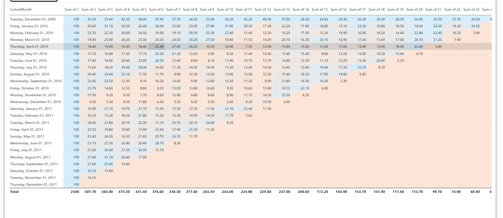
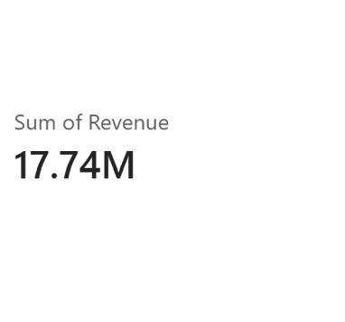
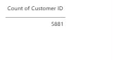
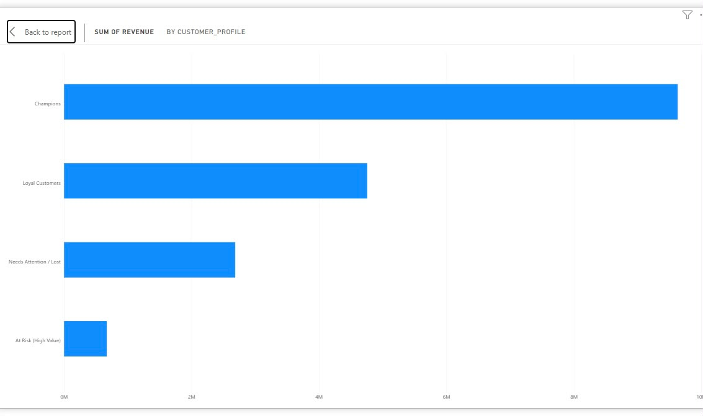

# E-Commerce Retail Analytics: Customer Segmentation & Cohort Retention

An end-to-end retail analytics project using Python, Pandas, SQLite, SQL and Power BI to investigate customer purchasing behaviour, revenue patterns, customer segmentation and retention.

The project uses the UCI Online Retail II dataset and demonstrates practical data cleaning, SQL-based data preparation, RFM analysis, cohort retention analysis and business-focused reporting.

---

## 1. Project Overview

The objective of this project is to analyse historical retail transactions and understand how customers purchase, how valuable different customer segments are, and how customer retention changes over time.

The analysis focuses on answering the following business questions:

- How much revenue is generated from retail transactions?
- How many unique customers are represented in the dataset?
- Which customers contribute the most monetary value?
- How can customers be segmented using Recency, Frequency and Monetary metrics?
- How does customer retention change across acquisition cohorts?
- At which stage of the customer lifecycle does retention begin to decline?

The findings are presented through SQL analysis, customer segmentation, cohort analysis and Power BI reporting visuals.

---

## 2. Dataset Information

**Dataset:** Online Retail II  
**Source:** UCI Machine Learning Repository  
**Business Domain:** E-Commerce / Retail  
**Original Dataset Size:** 1,067,371 records  
**Time Period:** December 2009 – December 2011

The Online Retail II dataset contains historical transactions from a UK-based online retailer specialising in giftware and homeware products.

### Dataset Source

The original dataset is available through the UCI Machine Learning Repository:

https://archive.ics.uci.edu/dataset/502/online+retail+ii

**Important Dataset Clarification**

The original UCI dataset contains 1,067,371 records. This repository uses a 244,618-record working dataset (`online_retail_II.csv`) for the analysis.

The repository's CSV is therefore not the complete original UCI dataset.

### Important Columns

| Column | Description |
|---|---|
| Invoice | Transaction invoice number |
| StockCode | Product identification code |
| Description | Product description |
| Quantity | Number of units purchased |
| InvoiceDate | Date and time of transaction |
| Price | Unit price |
| Customer ID | Unique customer identifier |
| Country | Customer's country |

---

## 3. Data Cleaning & Preparation

The working dataset initially contained 244,618 records.

SQL-based filtering and data preparation were performed to create a reliable dataset for customer-level analysis.

### Cleaning Operations

- Identified records with missing Customer IDs.
- Excluded transactions with non-positive quantities.
- Handled invalid or non-positive unit prices.
- Prepared transaction revenue using Quantity × Price.
- Prepared the cleaned transactions for customer-level RFM segmentation and cohort analysis.

### Data Cleaning Summary

| Metric | Records |
|---|---:|
| Original UCI Dataset | 1,067,371 |
| Working Dataset | 244,618 |
| Missing Customer ID | 53,165 |
| Cleaned Transactions | 186,406 |
| Total Excluded Records | 58,212 |
| Retention Percentage | 76.2% |

The retention percentage represents the proportion of working records retained after the cleaning process.

**Calculation:**

186,406 / 244,618 × 100 = 76.2%

The original UCI dataset size and the working dataset size are reported separately to maintain transparency about the data used in the analysis.

---

## 4. Exploratory Data Analysis & SQL Analysis

SQL was used through SQLite to perform data extraction, filtering, aggregation and customer-level analysis.

The analysis includes:

- Transaction-level revenue calculation.
- Customer-level aggregation.
- Revenue analysis.
- Customer counts.
- Data filtering and validation.
- RFM metric preparation.
- Cohort-based retention calculations.

### SQL Concepts Implemented

- SELECT and WHERE
- GROUP BY
- Aggregate functions
- Data filtering
- Customer-level aggregation
- SQLite database operations

Python and Pandas were used alongside SQL for data manipulation and analytical calculations.

---

## 5. Customer Segmentation: RFM Analysis

RFM analysis was performed to understand customer purchasing behaviour and identify different customer value groups.

The three metrics used are:

| Metric | Meaning |
|---|---|
| Recency (R) | How recently a customer made a purchase |
| Frequency (F) | How frequently a customer makes purchases |
| Monetary (M) | How much a customer spends |

Customer-level RFM metrics were calculated using historical transaction data.

The purpose of this analysis is to distinguish customers based on their purchasing activity and monetary contribution.

This provides a foundation for identifying valuable customers, understanding purchasing patterns and supporting targeted customer-retention strategies.

The resulting customer segmentation is exported to:

`2_RFM_Segments.csv`

---

## 6. Cohort Retention Analysis

Cohort analysis was performed to understand how customer retention changes over time.

Customers were grouped into cohorts based on their first purchase month.

Their subsequent purchasing activity was then tracked across later months.

### Analysis Objectives

- Understand customer retention over time.
- Compare purchasing behaviour across acquisition cohorts.
- Identify early customer lifecycle drop-offs.
- Examine how customer engagement changes after the first purchase.

### Key Finding

The December 2009 acquisition cohort recorded **35.3% retention in its second month**.

This indicates an early customer lifecycle drop-off and highlights an area worth investigating through customer engagement and retention initiatives.

The calculated cohort retention results are exported to:

`3_Cohort_Retention.csv`

---

## 7. Power BI Reporting & Visualizations

Power BI was used to create reporting visuals presenting the results of the retail analysis.

The report includes four major visual components:

1. **Revenue Summary KPI** – Displays total transaction revenue.
2. **Customer Count** – Presents customer-level metrics.
3. **RFM Customer Segmentation** – Shows the distribution of customer segments.
4. **Cohort Retention Matrix** – Displays retention patterns across acquisition cohorts.

### Dashboard Visuals

The repository contains screenshots of the Power BI reporting visuals.









**Dashboard Availability Note**

The Power BI report was developed, but the downloadable `.pbix` file and live interactive Power BI report are not included in this repository.

The screenshots are provided to demonstrate the reporting visuals created during the project.

---

## 8. Key Analytical Findings

The project demonstrates the following analytical findings:

- The working dataset contains 244,618 records before cleaning.
- 186,406 records were retained after data preparation.
- The cleaned dataset represents 76.2% of the working records.
- Customer purchasing behaviour was analysed through RFM metrics.
- Customers were segmented based on Recency, Frequency and Monetary value.
- Cohort analysis revealed 35.3% second-month retention for the December 2009 cohort.
- Four Power BI reporting visuals were developed to communicate the analytical results.

---

## 9. Technologies & Tools

| Category | Technologies |
|---|---|
| Programming | Python |
| Data Manipulation | Pandas |
| Database | SQLite |
| Query Language | SQL |
| Analysis | RFM Analysis, Cohort Analysis, EDA |
| Visualization | Power BI |
| Development Environment | Jupyter Notebook |
| Version Control | Git, GitHub |

---

## 10. Repository Structure

```text
retail_analysis/
│
├── Retail_analysis.ipynb
│
├── online_retail_II.csv
│
├── 1_Cleaned_Transactions.csv
│
├── 2_RFM_Segments.csv
│
├── 3_Cohort_Retention.csv
│
├── overall_record.jpeg
├── sum_ofrevenue.jpeg
├── count_id.jpeg
├── graphical_representation.jpeg
│
└── README.md
```

---

## 11. Running the Project

### Requirements

- Python 3.x
- Jupyter Notebook
- Pandas
- NumPy
- Matplotlib
- SQLite (available through Python's built-in `sqlite3` module)

### Installation

Install the required Python libraries:

```bash
pip install pandas numpy matplotlib jupyter
```

### Execution

1. Clone or download this repository.
2. Open `Retail_analysis.ipynb` in Jupyter Notebook.
3. Ensure `online_retail_II.csv` is available in the working directory.
4. Execute the notebook cells sequentially.
5. Review the cleaning operations, SQL queries, RFM segmentation and cohort retention analysis.

---

## 12. Project Limitations

- The analysis uses a 244,618-record working dataset rather than the complete 1,067,371-record UCI dataset.
- Customer-level analysis excludes records without valid customer identifiers.
- The Power BI `.pbix` file and interactive report are not currently included.
- The findings are based on historical transactional data and should not be interpreted as verified outcomes from an implemented business intervention.
- The analysis identifies retention patterns but does not establish the causes of customer churn.

---

## 13. Conclusion

This project demonstrates an end-to-end retail analytics workflow, covering data cleaning, SQL-based analysis, customer segmentation, cohort retention analysis and business-oriented reporting.

By combining Python, Pandas, SQLite, SQL and Power BI, the project transforms transactional records into structured customer and business insights.

It demonstrates practical applications of data analytics in e-commerce, particularly in understanding customer value, purchasing behaviour and retention patterns.

---

## Dataset Citation

Chen, D. (2012). Online Retail II [Dataset]. UCI Machine Learning Repository.

https://doi.org/10.24432/C5CG6D
